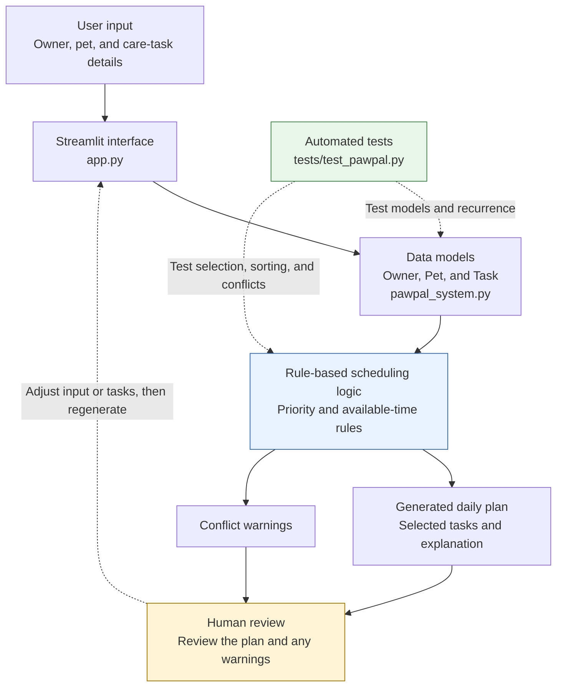

# PawPal+

PawPal+ is a pet-care planning project for CodePath AI110. This repository
identifies the original coursework as the **Module 2 Project** and documents
its progression from a class design to a working Streamlit interface; it does
not separately identify Module 1 or Module 3 deliverables. The app lets an
owner record pets and care tasks, then creates a priority-based plan that fits
the owner's available time and explains selected and skipped tasks.

PawPal+ helps organize routine care, but it does not provide veterinary advice
or use an AI model. Its scheduling logic is deterministic and rule-based.

## Features

- Enter owner availability and preferences, and add pets and care tasks.
- Store task duration, priority, due date, scheduled time, recurrence, and
  completion status.
- Generate a plan by selecting pending tasks in priority order while they fit
  the available-time budget; display an explanation for each decision.
- Review tasks by pet and completion status, mark tasks complete, and create
  daily or weekly recurring occurrences.
- Sort the task list by scheduled time and warn when valid pending tasks
  overlap on the same date.

Owner preferences are stored but are not used by the scheduler. The generated
plan does not arrange tasks into time slots or filter them by due date; time
and date are used for task-list sorting and conflict detection.

## Architecture Overview

The Streamlit interface in `app.py` collects input and updates the
`Owner`, `Pet`, and `Task` objects defined in `pawpal_system.py`. When the
user requests a plan, `Scheduler` applies priority and available-time rules
and returns the selected tasks with an explanation. The interface also shows
conflict warnings for the owner to review. The owner remains responsible for
deciding whether the plan is suitable and can change form values or add tasks
before generating the plan again.

The pytest suite exercises model behavior and core scheduling methods. It does
not currently test the Streamlit interface or perform an automatic quality
evaluation of a generated plan. A Streamlit startup smoke check is described
in the [test results log](tests/test_results.txt).



The standalone Mermaid source is [diagrams/system_architecture.mmd](diagrams/system_architecture.mmd).
The class diagram is [diagrams/uml_final.mmd](diagrams/uml_final.mmd).

## Setup and Run

From the project root, create and activate a virtual environment, then install
the declared dependencies:

```bash
python3 -m venv .venv
source .venv/bin/activate
python -m pip install -r requirements.txt
```

Start the Streamlit interface:

```bash
streamlit run app.py
```

Run the command-line demonstration:

```bash
python main.py
```

Run the automated tests:

```bash
python -m pytest -v
```

The commands above use `python` after activating the virtual environment. In
the validation environment for this repository, the executable was named
`python3`, so the recorded test run used `python3 -m pytest -v`.

## Sample Interactions

These examples call the same `Owner`, `Pet`, `Task`, and `Scheduler` classes
used by the application. The outputs below were produced by running the
examples against the project code.

### 1. Normal scheduling

**Input:** Riley has 45 minutes for Mochi's feeding and play tasks.

```python
from pawpal_system import Owner, Pet, Scheduler, Task

owner = Owner("Riley", 45, [])
pet = Pet("Mochi", "cat")
pet.add_task(Task("Feed Mochi", 15, 3))
pet.add_task(Task("Play with Mochi", 20, 2))
owner.add_pet(pet)

scheduler = Scheduler(owner)
print("Plan:", ", ".join(task.title for task in scheduler.generate_plan()))
print(scheduler.explain_plan())
```

**Observed output:**

```text
Plan: Feed Mochi, Play with Mochi
Selected 'Feed Mochi' (priority 3): it fits in the remaining time.
Selected 'Play with Mochi' (priority 2): it fits in the remaining time.
```

### 2. Priority with limited time

**Input:** Jordan has 35 minutes. A 30-minute walk has priority 3, medication
takes 10 minutes at priority 2, and play takes 5 minutes at priority 1.

```python
from pawpal_system import Owner, Pet, Scheduler, Task

owner = Owner("Jordan", 35, [])
pet = Pet("Buddy", "dog")
pet.add_task(Task("Walk Buddy", 30, 3))
pet.add_task(Task("Medication", 10, 2))
pet.add_task(Task("Play with Buddy", 5, 1))
owner.add_pet(pet)

scheduler = Scheduler(owner)
print("Plan:", ", ".join(task.title for task in scheduler.generate_plan()))
print(scheduler.explain_plan())
```

**Observed output:**

```text
Plan: Walk Buddy, Play with Buddy
Selected 'Walk Buddy' (priority 3): it fits in the remaining time.
Skipped 'Medication' (priority 2): not enough available time.
Selected 'Play with Buddy' (priority 1): it fits in the remaining time.
```

### 3. Overlapping scheduled tasks

**Input:** Buddy's 09:00 walk lasts 30 minutes and overlaps with a 09:15
feeding task on the same date.

```python
from datetime import date
from pawpal_system import Owner, Pet, Scheduler, Task

owner = Owner("Alex", 60, [])
pet = Pet("Buddy", "dog")
pet.add_task(Task(
    "Walk Buddy", 30, 3, scheduled_time="09:00", due_date=date(2025, 1, 1)
))
pet.add_task(Task(
    "Feed Buddy", 10, 2, scheduled_time="09:15", due_date=date(2025, 1, 1)
))
owner.add_pet(pet)

scheduler = Scheduler(owner)
print("Plan:", ", ".join(task.title for task in scheduler.generate_plan()))
print("Warnings:")
for warning in scheduler.detect_conflicts():
    print(warning)
```

**Observed output:**

```text
Plan: Walk Buddy, Feed Buddy
Warnings:
Scheduling conflict: Walk Buddy (09:00-09:30) overlaps with Feed Buddy (09:15-09:25).
```

Conflict detection reports an overlap but does not remove tasks from the plan
or move them to different times. The user must review the warning.

## Design Decisions and Limitations

- **Python data models:** `Owner`, `Pet`, and `Task` keep the domain objects
  simple and make the scheduling behavior testable without starting the UI.
- **Streamlit interface:** Streamlit provides a small interactive interface
  directly connected to those Python objects. State is held in Streamlit
  session state; there is no persistent database.
- **Greedy priority scheduling:** The scheduler sorts by descending priority
  and adds each positive-duration pending task if it fits the remaining time.
  This is easy to explain, but it is not a global optimizer: a high-priority
  long task can prevent a combination of lower-priority tasks from fitting.
- **Separate conflict checking:** Overlap warnings compare scheduled intervals
  for the same date. They alert the owner but do not change the generated
  plan. Cross-midnight overlaps are not detected.
- **No AI model:** The system uses explicit rules, not a trained model,
  generative agent, retriever, or evaluator. Preferences are collected but
  do not influence task selection.
- **Input limitations:** The Streamlit form restricts duration to positive
  values and times to its time picker. Direct Python callers can still create
  invalid task values; the scheduler skips non-positive durations and the
  conflict checker ignores invalid or missing scheduling details.

## Reliability and Evaluation

Automated testing is the project's reliability method. The suite in
`tests/test_pawpal.py` covers model behavior, sorting, filtering, recurrence,
plan selection, priority/time-budget decisions, and overlap detection. It
includes empty schedules, zero time, completed and non-positive-duration
tasks, missing scheduling details, invalid times, back-to-back tasks, and
overlaps across pets.

Final run: **26 tests passed, 0 failed** with `python3 -m pytest -v`. During
test development, one new assertion initially expected the invalid-duration
explanation to include a priority label; the observed implementation omits
that label for this case. The assertion was corrected to match the existing
behavior, and the final full run passed. No scheduling implementation change
was needed.

| Test input | Evaluation criteria | Actual result | Pass/Fail |
|---|---|---|---|
| 40-minute budget; tasks of 30 minutes/priority 3, 20/priority 2, and 10/priority 1 | Select tasks in priority order without exceeding the budget | Selected the 30-minute priority-3 task, skipped the 20-minute task, then selected the 10-minute task; total 40 minutes | Pass |
| Completed task, zero- and negative-duration tasks, plus a valid 10-minute task | Exclude completed/invalid tasks and include a task that fits | Only the valid 10-minute task was selected; completed and non-positive tasks were explained as skipped | Pass |
| No tasks; then a 10-minute task with zero available minutes | Handle an empty schedule and no-fit budget without an exception | Empty input returned no plan and “No care tasks are available”; zero minutes returned no plan with a no-fit explanation | Pass |
| Positive-duration task without a due date or scheduled time | Generate a plan when optional scheduling details are absent | The task was selected; due date and scheduled time are not required by plan generation | Pass |
| Two pets have tasks on the same date, one starting at 09:00 for 30 minutes and one at 09:15 for 10 minutes | Detect partial overlap across pets | Returned `Scheduling conflict: Walk Buddy (09:00-09:30) overlaps with Feed Luna (09:15-09:25).` | Pass |
| Tasks have missing or invalid times, are completed, or have zero duration | Ignore ineligible tasks during conflict checks | No conflict warning was returned for the tested invalid/ineligible inputs | Pass |

The command output is saved in [tests/test_results.txt](tests/test_results.txt).
An `AppTest` startup smoke check also completed without app exceptions and
confirmed that the default owner was initialized. Streamlit emitted its
expected bare-mode `ScriptRunContext` warning during that check. This is not a
full interactive browser test. No formal human-evaluation study was performed;
the interface presents plans and warnings for the owner to inspect.

Remaining gaps include automated UI interaction tests, tests for
cross-midnight conflicts, and broader validation of malformed direct API
inputs. The plan generator does not use due dates or scheduled times, and the
application has no automatic evaluator or AI model. These results demonstrate
tested deterministic behavior, not AI accuracy or suitability of pet-care
advice.

## Project Reflection

The existing [reflection](reflection.md) describes the design progression
from four focused classes to the Streamlit interface, and the trade-off
between a readable pairwise conflict check and a more complex optimization.
It also records the importance of reviewing AI assistance and running tests
rather than accepting generated code without verification. Owner preferences
and richer scheduling constraints remain possible improvements.

The graded personal AI-collaboration and responsible-AI reflection is kept in
[model_card.md](model_card.md); personal details not documented in the
existing reflection are clearly marked for the author to complete.
