# PawPal+ — AI-Powered Pet Care Planner

PawPal+ is a Python and Streamlit application for pet-care planning and
retrieval-grounded general pet-care guidance. It began as the original
CodePath AI110 Module 2 project for representing owners, pets, and care tasks
and creating an explained priority-based daily schedule.

The final AI110 project preserves that work and adds a **PawPal+ AI Pet Care
Assistant**. The assistant validates questions, searches local pet-care
references with TF-IDF, adds relevant passages to a Gemini prompt, returns a
general answer, and shows the supporting sources for human review.

## Main Features

- Dashboard metrics for pets, pending tasks, and available time.
- Multiple pets and owner availability/preferences.
- Care tasks with duration, priority, due date, scheduled time, and recurrence.
- Priority and available-time planning with written explanations.
- Same-date scheduling conflict warnings.
- Task filtering, sorting, completion, and recurring occurrences.
- A tabbed Streamlit interface for Dashboard, Pets & Tasks, Schedule, and AI
  Assistant.
- Genuine local RAG using TF-IDF/cosine similarity.
- Gemini generation grounded in retrieved context.
- Source attribution and expandable retrieved passages.
- Missing-key, missing-file, irrelevant-question, timeout, rate-limit, and
  invalid-response handling.
- Mocked automated model tests that require no paid API usage.

The deterministic scheduler remains the final authority for scheduling.
AI-generated suggestions never modify the schedule automatically.

## RAG Architecture

```text
Pet owner
  -> Streamlit interface
  -> question validation
  -> TF-IDF retriever
  -> local Markdown knowledge base
  -> relevant document chunks
  -> prompt with retrieved context and optional pet context
  -> Gemini 2.5 Flash
  -> grounded answer
  -> source attribution
  -> human review
```

RAG is useful here because it gives the assistant a bounded, inspectable
source set instead of relying only on model memory. Retrieved passages are
included directly in the prompt and displayed beside the answer.

The editable architecture diagram is
[diagrams/system_architecture.mmd](diagrams/system_architecture.mmd).

```mermaid
flowchart LR
    Owner[Pet owner] --> UI[Streamlit]
    UI --> Validate[Question validation]
    Validate --> Retrieve[TF-IDF retrieval]
    Retrieve --> KB[Knowledge base]
    KB --> Context[Retrieved context]
    Context --> Gemini[Gemini API]
    Gemini --> Answer[Grounded answer]
    Answer --> Sources[Sources]
    Sources --> Review[Human review]
```



## Knowledge Base

The `knowledge_base/` directory contains Markdown references for:

- Dog daily care
- Cat daily care
- Feeding and hydration
- Exercise and enrichment
- Grooming and hygiene
- Daily pet-care planning
- General preventive care

Each document records an original public source URL. The project does not
fabricate quotations or veterinary claims.

## Installation

Python 3.11 is recommended.

```bash
cd applied-ai-system-project
python3 -m venv .venv
source .venv/bin/activate
python3 -m pip install --upgrade pip
python3 -m pip install -r requirements.txt
```

Required runtime packages include Streamlit, scikit-learn, pytest, and
`google-genai`.

## Gemini API Configuration

Create a Gemini API key in Google AI Studio or the appropriate Gemini developer
console. Set it in the shell:

```bash
export GEMINI_API_KEY="your-key"
```

Alternatively, create `.streamlit/secrets.toml`:

```toml
GEMINI_API_KEY = "your-key"
```

Never commit `.env`, `.streamlit/secrets.toml`, or an API key.
[.env.example](.env.example) shows the environment-variable name.

Without a key, the scheduler and original PawPal+ features remain usable.
The AI Assistant explains that generation is unavailable.

## Running PawPal+

Run Streamlit:

```bash
streamlit run app.py
```

Run the command-line demonstration:

```bash
python3 main.py
```

## Automated Tests

Run the complete suite:

```bash
python3 -m pytest -v
```

Run only RAG tests:

```bash
python3 -m pytest -v tests/test_rag.py
```

Run retrieval evaluation:

```bash
python3 -m pytest -v tests/test_rag.py::test_retrieval_evaluation_dataset_reports_hit_at_3
```

The complete suite uses mocked model responses. No Gemini API usage or paid
service is required for test execution.

## Actual Retrieval Interaction Examples

These examples demonstrate actual local retrieval executed in this repository.
They are not claims of a live Gemini response. The model portion was not
executed because no Gemini key was available during validation.

### 1. Dog walking

**Input**

```text
How often should I walk my dog?
```

**Actual top retrieved source**

```text
Title: Dog Care Basics
Source: https://www.avma.org/resources-tools/pet-owners/petcare/dog-care
```

**Mocked model output for prompt-pipeline testing**

```text
Walking needs vary by the individual dog. The retrieved guidance says
physical activity should reflect age, health, size, and breed, and to ask a
veterinarian for an individual plan.
```

### 2. Cat care

**Input**

```text
What are important daily care activities for cats?
```

**Actual top retrieved source**

```text
Title: Cat Care Basics
Source: https://www.avma.org/resources-tools/pet-owners/petcare/cat-care
```

**Mocked model output for prompt-pipeline testing**

```text
The retrieved guidance highlights fresh water, appropriate feeding,
regular litter-area care, enrichment, rest, and routine veterinary care.
```

### 3. Mental stimulation

**Input**

```text
How can I keep my pet mentally stimulated?
```

**Actual top retrieved source**

```text
Title: Exercise and Mental Enrichment
Source: https://www.rspcapetinsurance.org.au/pet-care/dogs-and-cats/exercise-and-mental-stimulation
```

**Mocked model output for prompt-pipeline testing**

```text
The retrieved guidance suggests supervised play, training games, food
puzzles, rotating toys, and climbing opportunities for cats, with activities
adjusted to age, mobility, health, and preferences.
```

## Retrieval Evaluation

The labeled dataset in
[tests/evaluation_dataset.json](tests/evaluation_dataset.json) contains ten
questions with expected knowledge documents.

The actual local result was:

```text
Cases: 10
Hits at 3: 9
Hit@3: 0.90
```

Hit@3 means the expected document appeared among the three retrieved chunks.
This metric evaluates retrieval only. It does not automatically evaluate
generated answer quality or human medical usefulness.

## Design Decisions and Trade-offs

- **TF-IDF:** Easy to reproduce and inspect; less semantic than embeddings.
- **Markdown files:** Human-readable, source-attributed, and easy to add.
- **Top-k and threshold:** Reject clearly unrelated retrieval before model calls.
- **Pet context:** The UI includes the user's pet species and pending task names
  without inventing personal details.
- **Gemini 2.5 Flash:** Used for runtime generation; availability and rate limits
  depend on account configuration.
- **30-second timeout:** Limits a stalled request while preserving clear errors.
- **No automatic task creation:** AI answers inform the owner but never modify
  scheduling state.
- **Human review:** Sources and passages remain visible.
- **Session-only state:** PawPal+ does not use a database or persistent chat store.

## Testing Results

Actual complete-suite output is saved in
[tests/test_results.txt](tests/test_results.txt).

The suite covers:

- Existing scheduling, recurrence, filtering, sorting, and conflict behavior.
- Streamlit blank-title validation.
- Knowledge-document loading.
- Dog/cat, exercise, grooming, feeding, preventive-care, and planning retrieval.
- Species-aware retrieval.
- Empty and irrelevant questions.
- Missing knowledge files/directories.
- Missing API credentials.
- Mocked API failures.
- Retrieved-context injection into the model prompt.
- Source references in answer results.
- A 10-case Hit@3 evaluation.

No live Gemini call is included in the test evidence.

## Known Limitations

- TF-IDF can miss paraphrases or ambiguous natural language.
- The knowledge base is small and not continuously updated.
- Public general guidance cannot replace individualized veterinary care.
- The app cannot diagnose, prescribe medication, provide dosing, or guarantee
  safety for emergencies.
- A Gemini key and network are required for live generated answers.
- Streamlit chat history is session-only.
- Human answer quality and factual accuracy have not been formally measured.

## Project Reflection

PawPal+ demonstrates that a rules-based scheduler can remain reliable while a
separate RAG feature provides traceable general guidance. The implementation
required source curation, retrieval ranking, prompt grounding, credential
handling, UI integration, and tests for existing behavior. RAG reduces
unsupported answers by constraining model context, but retrieved context and
model wording still require human review.

Development assistance came from GitHub Copilot and earlier Gemini concept
exploration. The Copilot/Gemini development tools are distinct from the
runtime Gemini API used by the assistant. The responsible-AI draft is in
[model_card.md](model_card.md).
